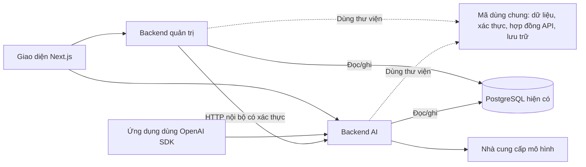
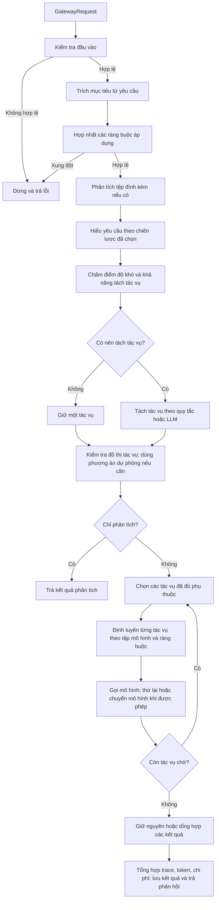

# Kiến trúc hệ thống

## Tổng quan

Hệ thống gồm giao diện Next.js trong `src/frontend/`, backend quản trị trong `src/backend/` và backend AI trong `src/backend_ai/`. Hai backend là hai ứng dụng FastAPI riêng, cùng sử dụng thư viện `src/shared/` và cơ sở dữ liệu PostgreSQL hiện có. Mỗi backend quản lý các endpoint và điều phối nghiệp vụ thuộc phạm vi của mình.

Xem [sơ đồ kiến trúc tổng quan](docs/architecture_diagram.md) để thấy các thành phần và kết nối giữa chúng.

## Các thành phần và lớp backend

Các package trong mã nguồn tương ứng với những vai trò quen thuộc trong Spring Boot:

| Trách nhiệm | Package | Vai trò tương ứng trong Spring Boot |
| --- | --- | --- |
| Tiếp nhận HTTP và trả mã trạng thái | `src/backend/routers`, `src/backend_ai/routers` | Controller |
| Định nghĩa dữ liệu trao đổi qua API | Các thư mục `dtos` của từng backend và `src/shared/dtos` | DTO |
| Xử lý nghiệp vụ và quản lý giao dịch | Các thư mục `services` của từng backend và `src/shared/services` | Service |
| Truy vấn và ghi dữ liệu | Các thư mục `repositories` của từng backend và `src/shared/repositories` | Repository |
| Định nghĩa thực thể lưu trong cơ sở dữ liệu | `src/shared/models` | Entity / Model |
| Khởi tạo ORM và phiên làm việc với cơ sở dữ liệu | `src/shared/database` | Cấu hình nguồn dữ liệu |
| Xác thực người dùng và xác thực riêng cho AI runtime | `src/shared/dependencies` / `src/backend_ai/dependencies` | Cấu hình bảo mật / dependency |
| Thực thi yêu cầu AI | `src/backend_ai/gateway` | Lõi nghiệp vụ / adapter |
| Thuật toán agent và chọn mô hình | `src/backend_ai/agents` | Thành phần nghiệp vụ |

Quy tắc chi tiết về phạm vi của từng package nằm trong [`src/README.md`](src/README.md).

## Luồng xử lý yêu cầu

1. Router tiếp nhận yêu cầu và kiểm tra dữ liệu bằng DTO Pydantic.
2. Router gọi service phụ trách nghiệp vụ tương ứng.
3. Service áp dụng quy tắc nghiệp vụ, điều phối các thành phần gateway và quản lý ranh giới giao dịch.
4. Repository truy vấn hoặc lưu các model SQLAlchemy.
5. Service trả về DTO phản hồi để FastAPI chuyển thành dữ liệu trả cho client.

Quan hệ phụ thuộc đi một chiều: backend quản trị và backend AI đều có thể import `shared`, còn `shared` không được import mã của hai backend. Hai backend cũng không import phần triển khai của nhau. `tests/test_package_boundaries.py` kiểm tra các quy tắc này; `tests/test_api/test_split_backends.py` kiểm tra backend quản trị có thể khởi động mà không cần thư viện AI.

## Luồng xử lý của AI Gateway

Đối với yêu cầu thực thi Gateway, `GatewayExecutionService` nạp cấu hình ứng dụng và tập mô hình khả dụng. `RequestPipeline` phân tích yêu cầu và tạo đồ thị tác vụ. Sau đó, `GatewayOrchestrator` định tuyến, thực thi và tổng hợp kết quả.

`RequestPipeline` thực hiện kiểm tra yêu cầu, trích mục tiêu, giải quyết ràng buộc, phân tích tệp đính kèm, hiểu ngữ nghĩa và chấm điểm. Chính sách phân rã có thể giữ một tác vụ, dùng cách tách theo quy tắc hoặc gọi LLM. Đồ thị tác vụ được kiểm tra; nếu không hợp lệ, pipeline dùng cách tách dự phòng. Riêng chế độ so sánh độ khó có thể gộp các tác vụ lại nếu việc tách không mang lại khác biệt cần thiết. Endpoint `/api/v1/gateway/analyze` trả kết quả ở đây, trước bước gọi mô hình để tạo câu trả lời.

Khi cần thực thi, `GatewayOrchestrator` dùng `SubtaskExecutor` để chọn mô hình và chạy từng nhóm tác vụ đã đủ phụ thuộc. Các tác vụ độc lập có thể chạy đồng thời; lỗi ở tác vụ đầu vào khiến tác vụ phụ thuộc bị đánh dấu thất bại. Mỗi tác vụ có thể thử lại hoặc chuyển sang mô hình dự phòng theo cấu hình. Với một tác vụ, chế độ tổng hợp tự động giữ nguyên kết quả; với nhiều tác vụ, nó chọn LLM nếu có, hoặc cách ghép theo quy tắc khi phù hợp định dạng đầu ra. Trace và chi phí được ghi trong các giai đoạn; kết quả cuối được lưu cùng biên nhận, mức sử dụng và khoản tính phí.

Các request `/v1/chat/completions` cần giữ nguyên giao thức message (ví dụ có tool call, nhiều lựa chọn hoặc tùy chọn sinh nội dung) đi qua `RequestPipeline` rồi dùng nhánh một tác vụ trong `execute_openai_messages`, thay vì luồng nhiều tác vụ ở sơ đồ trên. API `/v1/embeddings` có luồng thực thi riêng. Các package trong `src/backend_ai/gateway` chứa mã xử lý lõi; định tuyến theo dữ liệu ứng dụng nằm ở `src/backend_ai/services/gateway_routing_service.py` và việc thực thi tác vụ nằm ở `src/backend_ai/agents/routing/executor.py`. Cách tính giá dùng chung nằm ở `src/shared/core/pricing.py`.

## Điểm khởi chạy và hạ tầng

- `src/backend/main.py` đăng ký API quản trị, báo cáo, danh mục mô hình, tính phí và hỗ trợ (cổng 8000).
- `src/backend_ai/main.py` đăng ký API agent, thực thi pipeline, runtime riêng của hệ thống và API tương thích OpenAI (cổng 8001).
- Backend quản trị gọi backend AI qua HTTP nội bộ có xác thực, chẳng hạn `/internal/v1/support/synthesize` và `/internal/v1/models/{model_id}/probe`. Việc gọi nhà cung cấp và nạp thư viện chạy mô hình diễn ra trong backend AI; thông tin xác thực được lưu mã hóa trong cơ sở dữ liệu chung.
- Runtime giữ nguyên giao dịch ghi biên nhận, mức sử dụng và khoản tính phí. Hai tiến trình dùng chung model và lịch sử Alembic; việc tách backend không cần migration mới.
- `shared` là thư viện Python được nạp trong từng tiến trình, không phải dịch vụ thứ ba. Cấu hình của thư viện vẫn tìm `.env` ở thư mục gốc của repo.
- Frontend chọn `NEXT_PUBLIC_API_URL` hoặc `NEXT_PUBLIC_AI_API_URL` theo phương thức và đường dẫn yêu cầu. Có thể dùng `src/deploy/nginx.conf` để công bố một địa chỉ API chung và chặn các endpoint nội bộ.
- `src/shared/config.py` đọc cấu hình từ biến môi trường.
- `src/shared/database/base.py` quản lý metadata của SQLAlchemy.
- `src/shared/database/session.py` tạo engine và async session.
- `src/alembic/` quản lý migration schema và dùng `src.shared.models` làm nơi đăng ký các thực thể.

## Bảo mật

- `src/shared/core/security.py` xác minh bearer token.
- `src/shared/dependencies/auth.py` chứa các dependency kiểm tra quyền truy cập cho FastAPI.
- `src/shared/dependencies/domain_permissions.py` ánh xạ quyền theo từng miền nghiệp vụ.
- Khóa mã hóa thông tin xác thực và token dịch vụ được đọc từ cấu hình môi trường. Thông tin xác thực của nhà cung cấp được mã hóa khi lưu trong cơ sở dữ liệu; DTO và model không chứa API key ở dạng chưa mã hóa.
