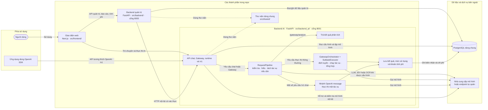

# Sơ đồ kiến trúc hệ thống

Sơ đồ tổng quan (System Architecture Diagram) dưới đây thể hiện các ứng dụng đang chạy, phần mã dùng chung, nơi lưu dữ liệu và các kết nối chính. Bên trong backend AI, sơ đồ phân biệt bước phân tích yêu cầu với hai nhánh thực thi chính.

Nét liền thể hiện luồng gọi API hoặc đọc/ghi dữ liệu; nét đứt thể hiện phụ thuộc vào thư viện Python. `src/shared/` được nạp trong cả hai tiến trình backend, không chạy như một dịch vụ HTTP riêng. Các mũi tên từ backend tới PostgreSQL biểu thị việc truy cập thông qua thư viện dùng chung.

Frontend chọn backend theo phương thức và đường dẫn yêu cầu. Backend quản trị gọi các endpoint nội bộ của backend AI để tổng hợp câu trả lời hỗ trợ và kiểm tra mô hình; các endpoint này có thể gọi nhà cung cấp mà không đi qua `RequestPipeline`. Trong luồng Gateway, `RequestPipeline` kiểm tra yêu cầu, giải quyết ràng buộc và tạo đồ thị tác vụ. Bước này có thể gọi LLM, JEV hoặc OCR tùy chiến lược được cấu hình. Endpoint `/api/v1/gateway/analyze` trả kết quả phân tích tại đây, trước bước thực thi các tác vụ để tạo câu trả lời. Yêu cầu thực thi thông thường đi tiếp qua `GatewayOrchestrator`, nơi các tác vụ được định tuyến, gọi mô hình và tổng hợp theo quan hệ phụ thuộc.

Một số yêu cầu `/v1/chat/completions` cần giữ nguyên cấu trúc message đi qua nhánh thực thi một tác vụ riêng. Kết quả thực thi được ghi cùng mức sử dụng và chi phí vào PostgreSQL. API `/v1/embeddings` có luồng xử lý riêng. Xem [tài liệu kiến trúc](../ARCHITECTURE.md) để đọc luồng AI Gateway chi tiết và quy tắc phân chia package.
